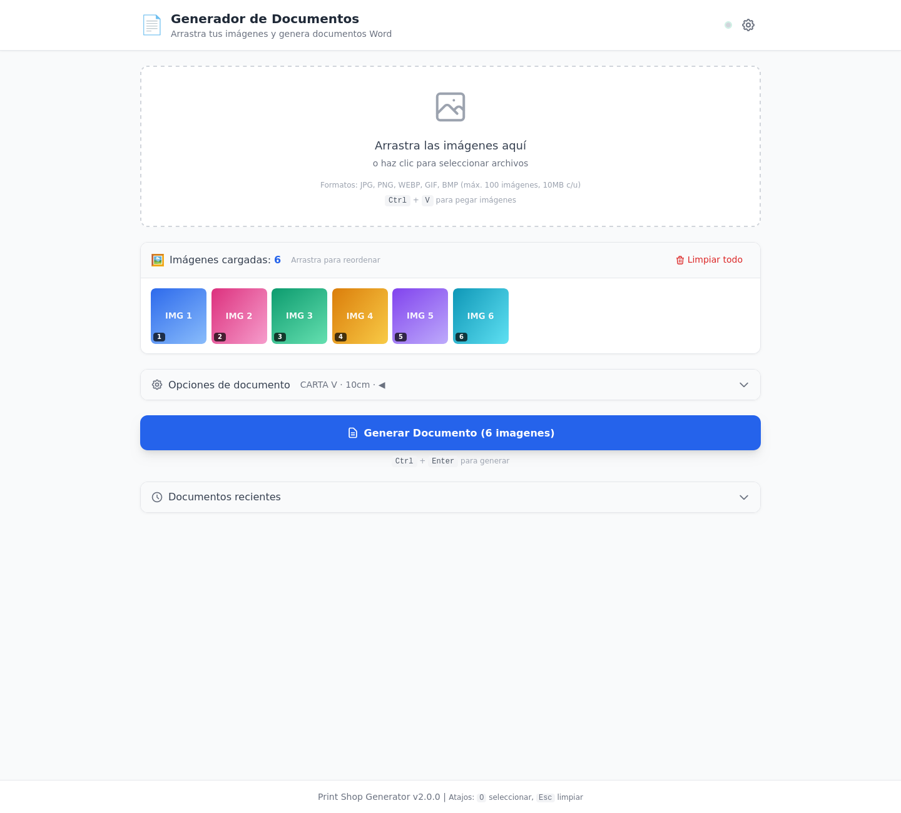
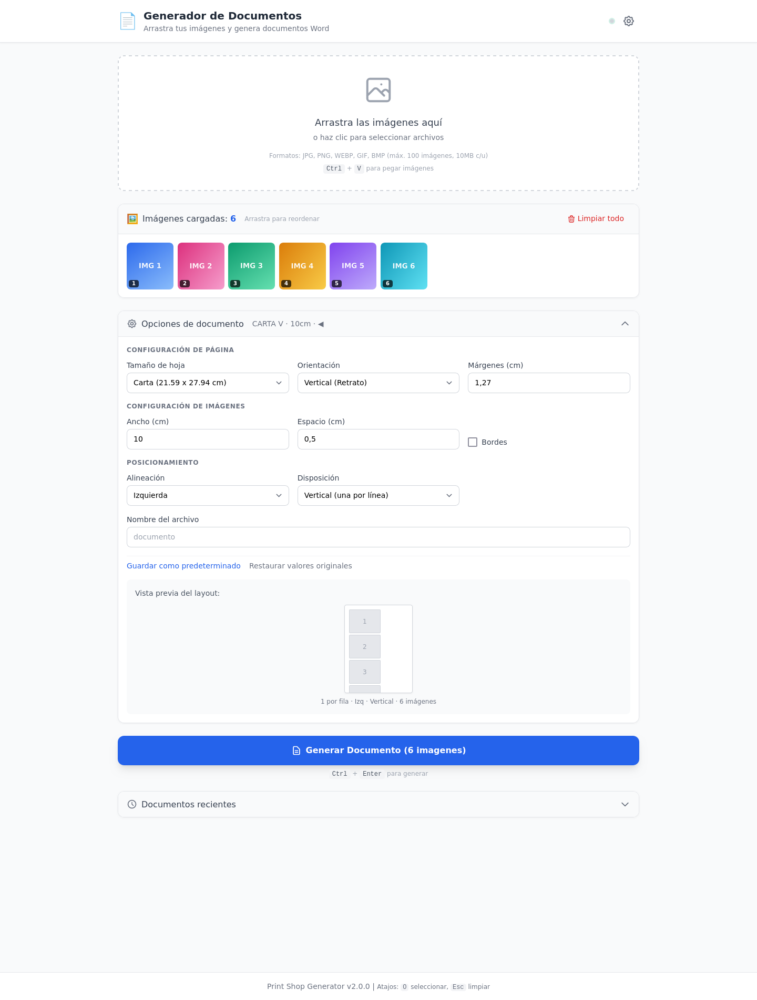

# Print Shop Generator

[](https://github.com/Jhoshoa/print-shop-agent/actions/workflows/deploy.yml)


[](LICENSE)

Aplicación web que convierte lotes de imágenes en documentos Word (.docx) listos para imprimir, pensada para el flujo diario de imprentas y papelerías: lo que antes se maquetaba a mano en Word ahora toma segundos.

**Demo en vivo:** https://print-shop-agent.onrender.com/

> La demo corre en el plan gratuito de Render: si estuvo inactiva, la primera carga puede tardar ~30-50 segundos mientras el servicio despierta.

## Descripción

Esta herramienta permite:
- Cargar múltiples imágenes (drag & drop, click, o Ctrl+V)
- Reordenar las imágenes arrastrándolas
- Configurar el layout del documento (tamaño de página, orientación, márgenes, etc.)
- Generar un documento Word listo para imprimir
- Mantener un historial de documentos generados

## Capturas de Pantalla

**Imágenes cargadas y listas para generar**



**Opciones de documento con vista previa del layout**



## Aspectos Técnicos Destacados

- **Motor de layout automático:** calcula cuántas imágenes caben por fila según tamaño de hoja, orientación y ancho de imagen, y estima el número de páginas. Soporta disposición en grilla (tabla) o vertical.
- **Pipeline de imágenes:** validación de formato, tamaño y dimensiones; redimensionado y conversión con Pillow antes de insertarlas con python-docx.
- **Frontend modular sin frameworks:** componentes ES6 independientes (dropzone, grilla ordenable, panel de opciones, vista previa, historial) y cliente API con reintentos.
- **CI/CD completo:** cada push a `main` ejecuta Ruff, pytest con umbral de cobertura y build de Docker; si todo pasa, dispara el deploy en Render.
- **Contenedor único:** el backend FastAPI sirve también el frontend estático, con health checks para la plataforma de hosting.

## Requisitos del Sistema

### Opción 1: Docker (Recomendado)
- Docker Desktop
- 200MB de espacio en disco

### Opción 2: Instalación Local
- Python 3.10 o superior
- Navegador web moderno (Chrome, Firefox, Safari, Edge)
- 100MB de espacio en disco

## Instalación Rápida

```bash
# 1. Clonar o descargar el proyecto
cd print-shop-agent

# 2. Crear entorno virtual
python -m venv venv

# 3. Activar entorno virtual
# Windows:
venv\Scripts\activate
# Linux/Mac:
source venv/bin/activate

# 4. Instalar dependencias
pip install -r requirements.txt
```

## Ejecución

### Inicio Rápido

```bash
# Windows
scripts\start.bat
```

### Manual

```bash
# Activar entorno virtual
venv\Scripts\activate  # Windows
source venv/bin/activate  # Linux/Mac

# Iniciar servidor
cd backend
python -m uvicorn app.main:app --reload
```

Abrir en el navegador: **http://localhost:8000**

## Docker

### Ejecutar con Docker Compose

La forma más sencilla de ejecutar la aplicación es usando Docker:

```bash
# Construir e iniciar los contenedores
docker-compose up -d

# Ver logs
docker-compose logs -f

# Detener
docker-compose down

# Verificar archivos generados en el contenedor
docker exec print-shop-app sh -c "ls -la /app/backend/output/"
```

> **Nota:** Al iniciar el contenedor, se borran automáticamente los archivos `.docx` anteriores de la carpeta output.

Acceder en: **http://localhost** (puerto 80)

### Configurar Dominio Local (Opcional)

Para acceder mediante `http://print-shop-agent.com`:

1. Abrir **PowerShell como Administrador**
2. Ejecutar:
```powershell
cd C:\Users\<username>\Documents\print-shop-agent\scripts
Set-ExecutionPolicy -ExecutionPolicy RemoteSigned -Scope CurrentUser -Force
.\add-hosts-entry.ps1
```

El script `add-hosts-entry.ps1`:
- Agrega `127.0.0.1 print-shop-agent.com` al archivo hosts de Windows
- Limpia el cache DNS automáticamente
- Verifica permisos de administrador

### Publicar en Docker Hub

```powershell
# Primero hacer login (solo una vez)
docker login

# Usar el script para build + push con version
.\scripts\docker-push.ps1 -Version 1.0.0

# O especificar usuario
.\scripts\docker-push.ps1 -Version 1.0.0 -Usuario tu-usuario
```

El script `docker-push.ps1`:
- Construye la imagen con la versión especificada
- Crea el tag `latest` automáticamente
- Sube ambos tags a Docker Hub

### Descargar desde Docker Hub

```bash
# Descargar y ejecutar
docker pull <username>/print-shop-generator:latest
docker run -d -p 80:8000 <username>/print-shop-generator:latest
```

### Deploy en Render.com (Cloud)

**Producción:** https://print-shop-agent.onrender.com/

El proyecto incluye configuración para deploy automático en Render.com:

1. Crear cuenta en [Render.com](https://render.com)
2. Conectar repositorio de GitHub
3. Render detectará `render.yaml` automáticamente
4. Configurar secret en GitHub: `RENDER_DEPLOY_HOOK_URL`

**CI/CD Pipeline:**
- Push a `main` → Tests → Deploy automático
- Pull Request → Solo ejecuta tests

Ver documentación completa en [`docs/deploy-render-analisis.md`](docs/deploy-render-analisis.md)

## Uso

1. **Cargar imágenes**: Arrastra archivos al área de carga, haz clic para seleccionar, o usa Ctrl+V para pegar
2. **Reordenar**: Arrastra las miniaturas para cambiar el orden
3. **Configurar**: Ajusta el tamaño de página, orientación, márgenes, etc.
4. **Generar**: Haz clic en "Generar Documento" o presiona Ctrl+Enter
5. **Descargar**: El documento se descarga automáticamente

## Atajos de Teclado

| Atajo | Acción |
|-------|--------|
| `O` | Abrir selector de archivos |
| `Ctrl + V` | Pegar imagen |
| `Ctrl + Enter` | Generar documento |
| `Escape` | Limpiar imágenes |

## Estructura del Proyecto

```
print-shop-agent/
├── backend/                 # Servidor FastAPI
│   ├── app/
│   │   ├── api/            # Endpoints REST
│   │   ├── core/           # Configuración
│   │   ├── models/         # Schemas Pydantic
│   │   └── services/       # Lógica de negocio
│   ├── tests/              # Tests con pytest
│   └── README.md
├── frontend/               # Interfaz web
│   ├── js/
│   │   ├── components/     # Componentes UI
│   │   ├── services/       # API y Storage
│   │   └── utils/          # Utilidades
│   ├── css/
│   └── README.md
├── scripts/                # Scripts de utilidad
│   ├── start.bat           # Iniciar servidor (Windows)
│   ├── test.bat            # Ejecutar tests (Windows)
│   ├── entrypoint.sh       # Entrypoint Docker (limpieza)
│   ├── add-hosts-entry.ps1 # Configurar DNS local (Admin)
│   ├── docker-push.ps1     # Publicar en Docker Hub (Windows)
│   └── docker-push.sh      # Publicar en Docker Hub (Linux/Mac)
├── .github/workflows/      # GitHub Actions CI/CD
│   └── deploy.yml          # Pipeline de tests y deploy
├── docs/                   # Documentación adicional
├── Dockerfile              # Imagen Docker (backend + frontend)
├── docker-compose.yml      # Orquestación de contenedores
├── render.yaml             # Configuración Render.com
├── requirements.txt        # Dependencias de producción
├── requirements-dev.txt    # Dependencias de desarrollo
└── README.md
```

## Tests

```bash
# Ejecutar todos los tests
pytest backend/tests -v

# Con cobertura
pytest backend/tests --cov=backend/app --cov-report=html

# Usando script (Windows)
scripts\test.bat
```

## Configuración Disponible

| Opción | Valores | Default |
|--------|---------|---------|
| Tamaño de página | Carta, A4, A3, Oficio, Legal | Carta |
| Orientación | Vertical, Horizontal | Vertical |
| Ancho de imagen | 1-30 cm | 10 cm |
| Imágenes por fila | Auto, 1-6 | Auto |
| Márgenes | 0.5-5 cm | 1.5 cm |
| Espaciado | 0-3 cm | 0.5 cm |
| Bordes | Sí/No | No |

## API REST

| Método | Endpoint | Descripción |
|--------|----------|-------------|
| GET | `/api/health` | Estado del servidor |
| GET | `/api/health/status` | Estado del sistema (CPU, memoria, disco) |
| GET | `/api/config/defaults` | Configuración por defecto |
| GET | `/api/config/page-sizes` | Tamaños de página disponibles |
| POST | `/api/generator/generate` | Generar documento |
| GET | `/api/generator/download/{filename}` | Descargar documento |
| GET | `/api/generator/files` | Listar documentos generados |
| DELETE | `/api/generator/files/{filename}` | Eliminar documento |

Documentación interactiva (solo en desarrollo): http://localhost:8000/docs

## Tecnologías

### Backend
- FastAPI
- python-docx
- Pillow
- Pydantic
- Uvicorn

### Frontend
- JavaScript ES6 (Vanilla)
- TailwindCSS
- HTML5 APIs (Drag & Drop, File, Clipboard)

### Calidad y DevOps
- pytest, pytest-cov, Ruff, mypy
- Docker y docker-compose
- GitHub Actions (CI/CD)
- Render.com (hosting) y Docker Hub

## Limitaciones

- Máximo 100 imágenes por documento
- Máximo 10MB por imagen
- Formatos: JPG, PNG, WebP, GIF, BMP

## Licencia

[MIT](LICENSE) - Uso libre para proyectos personales y comerciales.

## Soporte

Para reportar bugs o solicitar funcionalidades:
1. Revisa la documentación en `/docs`
2. Revisa los READMEs en `/backend` y `/frontend`
3. Contacta al desarrollador
